# Hackathon AI Architecture

> Historical template architecture, not the current finance release design. The authenticated finance paths now use Firebase Auth/Firestore and Netlify Node Functions; SQLite/D1 and the in-memory approval descriptions below are legacy context. Start with the [current architecture, release scope and continuation checkpoint](seguridad/22-recapitulacion-y-plan-de-continuidad.md).

Hackathon AI is a Nuxt 4 application that helps teams manage Quarterly Rocks, Sprints, and Tasks through a conversational AI assistant. The system combines a modern Vue frontend, a Nitro backend, LangGraph orchestration, Gemini models, and SQLite persistence to support planning, approvals, and document-grounded Q&A.

## Tech Stack

| Layer | Technologies |
|---|---|
| Frontend | Nuxt 4, Vue 3, @nuxt/ui v4, Tailwind CSS v4, DM Sans (@nuxt/fonts) |
| Backend | Nitro (Nuxt server), H3, Server-Sent Events (SSE) |
| AI Orchestration | LangGraph (StateGraph) |
| AI Models | Google Gemini 2.5 Flash (chat + classification), Gemini Embedding 001 (embeddings) |
| Database | SQLite via better-sqlite3 + Drizzle ORM |
| Icons | Lucide via @nuxt/ui |

## Repository Layout

```text
app/              -> Frontend (pages, components, composables)
  pages/
    index.vue             -> Main layout: chat column + backlog column
    index/index.vue       -> Default route: BacklogPanel
    index/preview.vue     -> Plan preview and approval form
    dashboard.vue         -> Executive Dashboard: KPIs, rocks progress, sprints overview
  components/
    chat/
      ChatPanel.vue       -> Chat UI shell (messages + input)
      ChatInput.vue       -> Textarea + file attach button
      ChatMessage.vue     -> Message bubble with role-based styles
      AgentStatus.vue     -> Processing/idle status badge
    backlog/
      BacklogPanel.vue    -> Tabbed list (Rocks / Sprints / Tasks)
      RockCard.vue        -> Rock item card
      SprintCard.vue      -> Sprint item card
      TaskCard.vue        -> Task item card
  composables/
    useChat.ts            -> Messages state, SSE streaming, sendMessage, submitAction
    usePlanPreview.ts     -> Preview state: plan, actionId, tempId
    useBacklog.ts         -> Rocks/Sprints/Tasks fetch + refresh
  assets/css/main.css     -> Global CSS: Tailwind + Nuxt UI + design tokens
  app.config.ts           -> Nuxt UI overrides: UCard overflow-visible

server/           -> Backend (API routes, agents, DB)
  api/
    chat.post.ts          -> SSE endpoint: receives message+action, streams agent events
    upload.post.ts        -> Document upload: parse -> chunk -> embed -> SQLite
    documents/[tempId].delete.ts -> Delete provisional document by tempId
  agents/
    graph.ts              -> LangGraph StateGraph: supervisor -> planner/strategy/data/knowledge
    supervisor.ts         -> Gemini classifier: routes intent to correct node
    strategy-planner.ts   -> Generates full Rock+Sprint+Task proposal (no DB write)
    planner.ts            -> Generates task proposals for existing Rock+Sprint
    data-agent.ts         -> CRUD operations (create rock/sprint, delete, approve)
    knowledge.ts          -> RAG query: semantic search + Gemini answer
    judge.ts              -> LLM-as-a-Judge: cross-references task completion against RAG documents
    retrospective.ts      -> Sprint Retrospective: generates structured LLM summary from sprint task data
    state-store.ts        -> In-memory Maps for pending approvals (tasks, plan, delete)
    tools/
      sql-tools.ts        -> Drizzle DB operations with date validation
      rag-tools.ts        -> searchDocuments (cosine similarity), summarizeDocument
  db/
    schema.ts             -> Drizzle schema: rocks, sprints, tasks, documents, documentChunks
    index.ts              -> SQLite connection + CREATE TABLE IF NOT EXISTS + safeAlter
  utils/
    chunker.ts            -> Text chunking for embedding
    embeddings.ts         -> GoogleGenerativeAIEmbeddings (gemini-embedding-001)
    pdf-parser.ts         -> Extract text from .txt / .md / .pdf (pdf-parse)
  plugins/
    cleanup.ts            -> Nitro plugin: delete orphaned provisional docs on startup + close
  composables/
    useGeminiApiKey.ts    -> Read GEMINI_API_KEY from runtimeConfig

shared/           -> Cross-layer TypeScript types
  types/
    chat.ts               -> ChatMessage, UiAction, ChatRole
    plan.ts               -> ProposedPlan, ProposedSprint
    task.ts               -> ProposedTask, TaskPriority
  utils/
    date.ts               -> normalizeDateToDb, normalizeDateToUser, userDateToDb
```

## Architecture Overview

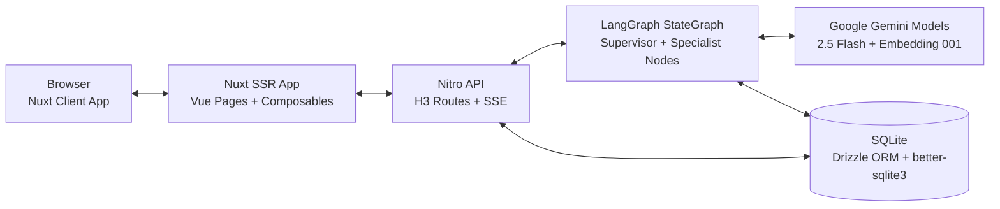

## Database Schema

### Tables

| Table | Purpose | Primary Key | Notes |
|---|---|---|---|
| rocks | Quarterly objectives | id (TEXT) | IDs follow R-XXXX |
| sprints | Time-boxed execution windows | id (TEXT) | Linked to rocks via rock_id; IDs follow S-XXXX |
| tasks | Work items inside rocks/sprints | id (TEXT) | Linked to rock_id and sprint_id; IDs follow T-XXXX |
| documents | Uploaded source documents | id (INT autoincrement) | Optional rock_id and temp_id for provisional linkage |
| documentChunks | Embedding-backed chunks for RAG | id (INT autoincrement) | Stores chunk text + embedding JSON |

### ER Diagram

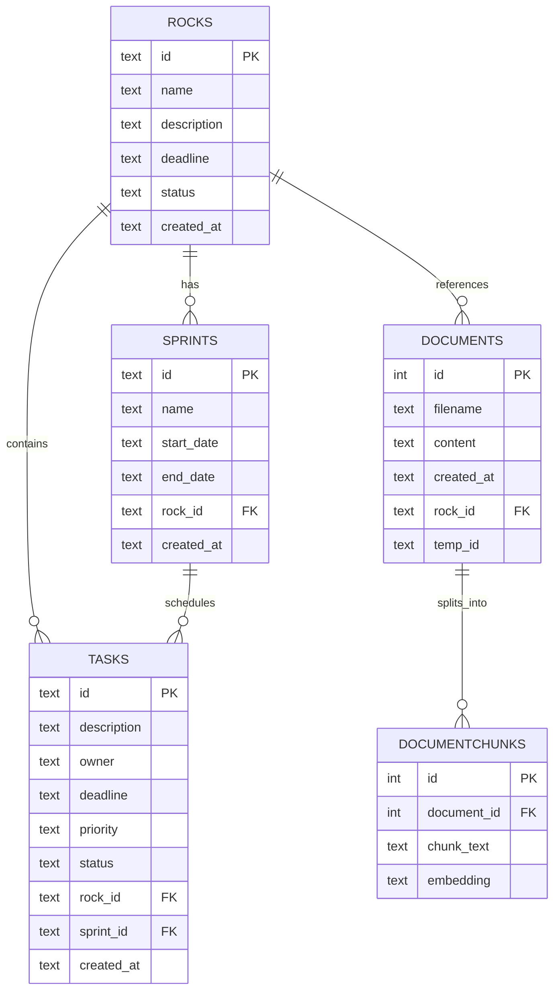

## Agent Routing

The LangGraph StateGraph uses this node sequence:

- `supervisor` -> `planner` or `strategy` or `data` or `knowledge` -> `END`
- Deterministic bypass: `approve_tasks`, `approve_plan`, and `confirm_delete` skip Gemini classification and route directly to `data`.

### Routing Rules

| Path | Trigger | Behavior |
|---|---|---|
| strategy + generate_plan | Free-form planning goals without strict IDs | Builds full Rock + Sprints + Tasks proposal in memory |
| planner + plan_tasks | Existing Rock + Sprint decomposition (expects R-XXXX + S-XXXX) | Generates tasks for existing IDs; falls back to strategy when IDs are missing |
| data + CRUD/approvals | create_rock, create_sprint, delete_rock, list_backlog, approve_tasks, approve_plan, confirm_delete | Executes validated data operations and approval actions |
| knowledge + rag_query | Document questions | Runs semantic search over embeddings and synthesizes answer with Gemini |
| data + update_sprint_status / update_task_status | User asks to update a status via chat | Updates status in DB; if task is marked completed, conditionally routes to judge node |
| retro + generate_retrospective | User asks for sprint retro / retrospective / sprint review with S-XXXX | Generates structured sprint summary with LLM |
| END | Ambiguous/insufficient request | Asks for clarification |

### Flowchart

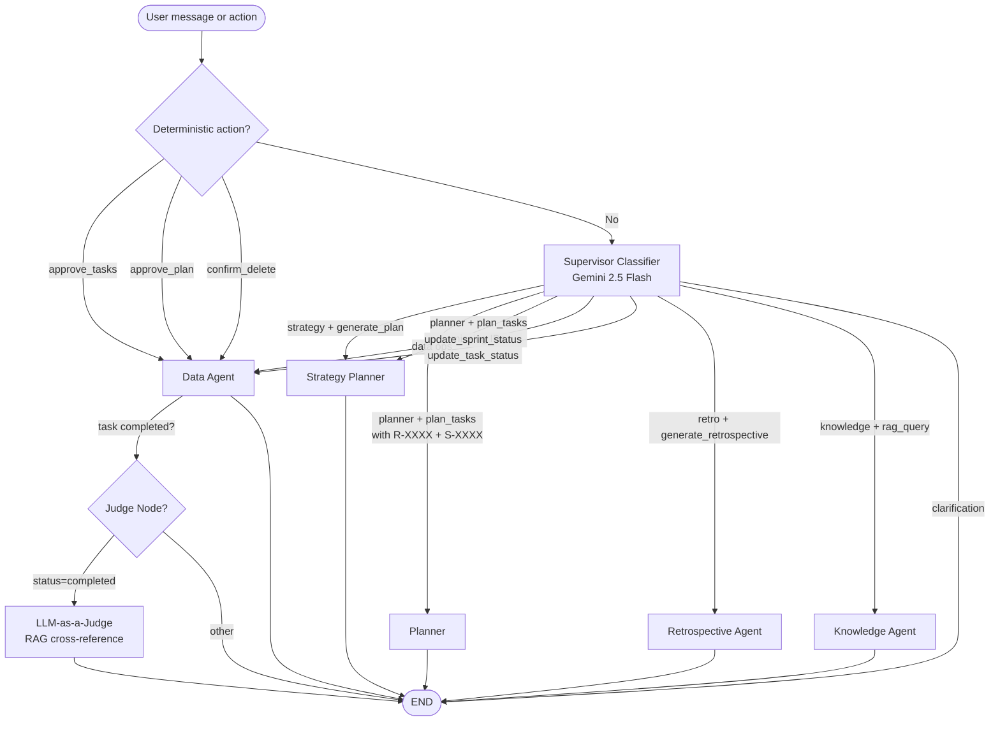

## Document Upload and RAG

### End-to-End Behavior

1. User clicks Attach in chat input and chooses a `.txt`, `.md`, or `.pdf` file (max 5 MB).
2. Client generates `tempId` (UUID) and uploads to `POST /api/upload` using `FormData`.
3. Server parses text (`pdf-parse` for PDFs), chunks content, generates embeddings (`gemini-embedding-001`), and stores rows in `documents` and `documentChunks`.
4. Client stores `tempId` in plan preview state.
5. If plan is approved, `approve_plan` links `documents.rock_id = newRockId` where `temp_id = tempId`.
6. If plan is canceled, `DELETE /api/documents/:tempId` removes provisional document and chunks.
7. For RAG queries, `searchDocuments` computes cosine similarity between query embedding and stored chunk embeddings, then returns top-3 matches.

### Sequence Diagram

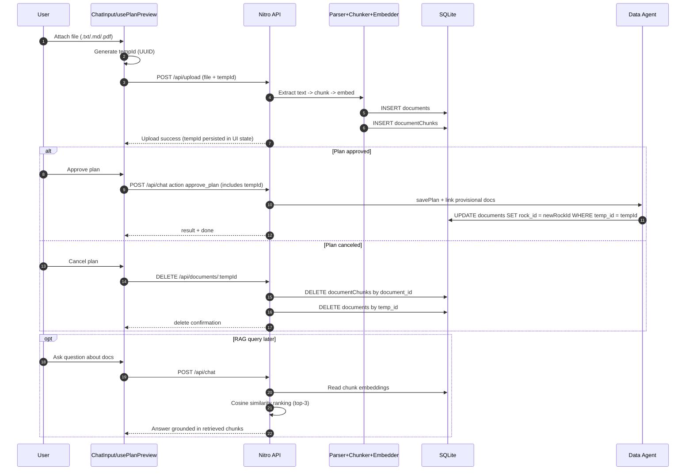

### Orphan Cleanup

- On startup, a Nitro plugin deletes provisional rows where `temp_id` is set and `rock_id` is null.
- On graceful shutdown (`nitroApp.hooks.hook("close")`), the same cleanup runs again.

## SSE Chat Protocol

### Request

`POST /api/chat`

```json
{
  "sessionId": "string",
  "message": "string",
  "action": {
    "type": "optional",
    "actionId": "optional",
    "payload": {}
  }
}
```

### Streamed Events

```text
data: {"type":"status","message":"Supervisor starting..."}
data: {"type":"status","message":"..."}
data: {"type":"result","message":"...","proposedTasks":null,"proposedPlan":null,"actionRequest":null,"refreshBacklog":false}
data: {"type":"error","message":"..."}
data: {"type":"judge","message":"Warning: task marked complete but transcript indicates ongoing blockers"}
data: {"type":"guardrail","message":"Sprint Boundary Rule: deadline must fall within sprint dates"}
data: {"type":"done"}
```

### Sequence Diagram

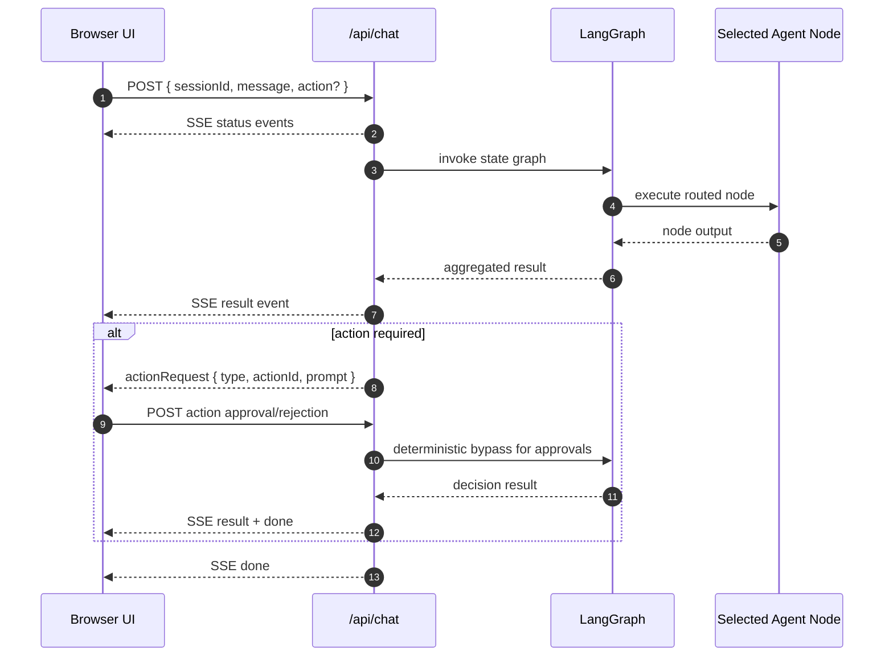

## Plan Preview and Approval

### Workflow

1. Strategy agent generates `ProposedPlan` in memory (rock + sprints + tasks).
2. Plan is stored in `state-store` with an `actionId`.
3. SSE result includes `proposedPlan` and `actionRequest` of type `approve_plan`.
4. Client updates preview state and navigates to `/preview`.
5. User edits fields in the preview form.
6. On Approve: client sends `submitAction(approve_plan)` with edited plan and optional `tempId`; data agent validates dates, persists rock/sprints/tasks, and links documents.
7. On Cancel: client calls `DELETE /api/documents/:tempId`, clears preview state, and returns to `/`.

### Sequence Diagram

```mermaid
sequenceDiagram
  autonumber
  participant U as User
  participant UI as useChat + usePlanPreview
  participant CHAT as /api/chat
  participant STRAT as Strategy Planner
  participant STORE as state-store (in-memory)
  participant DATA as Data Agent
  participant DB as SQLite

  U->>UI: Request planning goal
  UI->>CHAT: POST /api/chat
  CHAT->>STRAT: generate_plan
  STRAT->>STORE: save proposedPlan by actionId
  CHAT-->>UI: SSE result (proposedPlan + actionRequest approve_plan)
  UI->>UI: "setPlan(); navigate /preview"
  U->>UI: Edit plan fields

  alt Approve
    U->>UI: Approve
    UI->>CHAT: POST action approve_plan (edited plan + tempId)
    CHAT->>DATA: validate dates + savePlan()
    DATA->>DB: INSERT rock/sprints/tasks
    DATA->>DB: Link documents by tempId (if present)
    CHAT-->>UI: SSE result refreshBacklog=true + done
    UI->>UI: "clearPlan(); navigate /"
  else Cancel
    U->>UI: Cancel
    UI->>CHAT: Optional reject action
    UI->>UI: DELETE /api/documents/:tempId
    UI->>UI: "clearPlan(); navigate /"
  end
```

### In-Preview Modification (`modify_plan`)

While the preview is open, the user can type a modification request in the chat (e.g. "add a sprint" or "remove the last task of sprint 1"). The supervisor detects `modify_plan` and routes to the data agent without requiring a new approval ID.

**Flow:**

1. Supervisor detects `modify_plan` operation (using `hasPendingPlan` context — no Gemini call needed for deterministic detection).
2. Data agent calls `findPendingPlanBySessionId` to retrieve the current pending plan.
3. Calls Gemini 2.5 Flash with the current plan JSON + user instruction (temperature=0.2).
4. Parses the updated plan JSON from the response.
5. Re-saves to `state-store` under the **same `actionId`** so the existing approval button still works.
6. Returns `proposedPlan` + `actionRequest(approve_plan)` so the frontend refreshes the preview in place.

**Key constraint:** The `actionId` is reused, not regenerated. This means the user can modify the plan multiple times and the final "Approve" button always submits the latest version.

---

## Agents in Depth

This section explains each agent node, what it does internally, what it receives, what it returns, and how it relates to the other nodes.

### Shared State (AgentState)

All nodes share a common state object managed by LangGraph:

```ts
{
  sessionId: string          // Identifies the user session
  message: string            // Original user text or "Approval action"
  action: object | null      // Present when user clicks an approval button
  intent: AgentIntent | null // Set by supervisorNode, consumed by all others
  response: string           // Final text response sent to the user
  proposedTasks: ProposedTask[] | null
  proposedPlan: ProposedPlan | null
  judgeWarning: string | null  // Set by judgeNode if task completion contradicts RAG documents
  guardrailError: string | null // Set by dataNode if a guardrail rule was violated
  actionRequest: object | null  // Pending approval action sent back to UI
  refreshBacklog: boolean    // Whether the UI should reload backlog data
}
```

Each node receives the full state and returns only the fields it changes. LangGraph merges the result into state before passing it to the next node.

---

### 1. Supervisor Node

**File:** `server/agents/supervisor.ts`  
**Purpose:** Decides which node should handle the message. Acts as the traffic controller.

**Flow:**

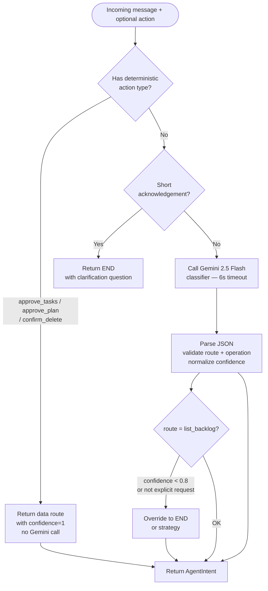

**Key behaviors:**
- **Deterministic bypass**: `approve_tasks`, `approve_plan`, and `confirm_delete` never call Gemini. They return a hardcoded `data` route with `confidence: 1`. This guarantees approvals are never misrouted even if the message is ambiguous.
- **Short acknowledgement guard**: Messages like "ok", "gracias", "listo" route to `END` with a clarification question — they never trigger planning.
- **`list_backlog` gate**: Even if Gemini returns `list_backlog`, it only passes through if `confidence >= 0.8` AND the message contains an explicit backlog list request. Otherwise it falls back to `END` or `strategy`.
- **Timeout protection**: Gemini call is raced against a 6-second timeout. On failure, falls back to `strategy` for substantial messages or `END` for short ones.
- **Classifier prompt rules** (sent to Gemini at temperature=0):
  - Free-form planning goals without `R-XXXX`/`S-XXXX` IDs → `strategy`
  - Planning with explicit IDs → `planner`
  - CRUD operations, date-based creation → `data`
  - Document/transcript questions → `knowledge`
  - Ambiguous/short → `END`

**Returns:** `AgentIntent` with `route`, `operation`, `confidence`, `rockId?`, `sprintId?`, `clarificationQuestion?`

---

### 2. Strategy Planner Node

**File:** `server/agents/strategy-planner.ts`  
**Purpose:** Generates a complete plan proposal (one Rock + 1–3 Sprints + 3–8 Tasks per Sprint) from a free-form user goal. **Does not write to the database.**

**Flow:**

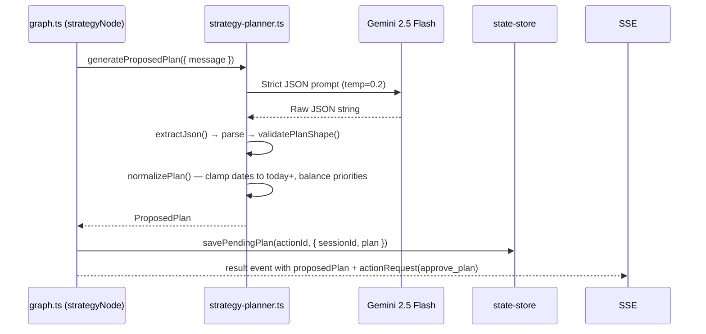

**Key behaviors:**
- All dates are clamped to today minimum via `clampDbDate`. The LLM cannot produce past dates.
- Sprint priorities are rebalanced if all tasks have the same priority (cycles through high/medium/low).
- `normalizePlan` validates structure: exactly 1 rock, 1–3 sprints, 3–8 tasks per sprint. Invalid output throws an error rather than saving corrupt data.
- The plan is stored in `state-store` (in-memory Map) keyed by `actionId`. It is only written to DB if the user approves.

**Input:** `{ message: string }`  
**Returns:** `{ response, proposedPlan, actionRequest: { type: "approve_plan", actionId, prompt } }`

---

### 3. Planner Node

**File:** `server/agents/planner.ts`  
**Purpose:** Generates task proposals for an **existing** Rock + Sprint. Requires both IDs to exist in the database.

**Flow:**

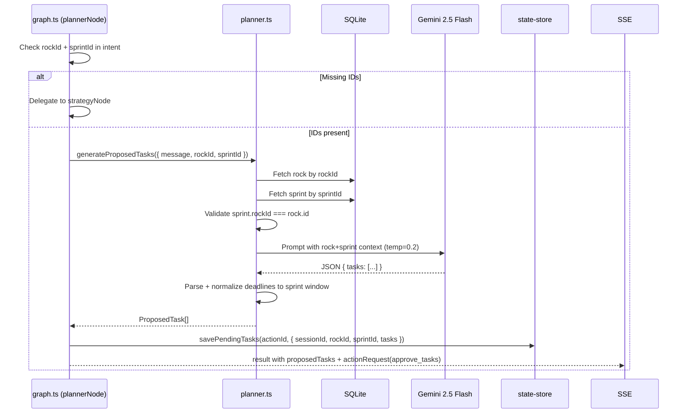

**Key behaviors:**
- If `rockId` or `sprintId` is missing from intent, `plannerNode` immediately delegates to `strategyNode` — no error is thrown to the user.
- Validates sprint belongs to the rock before calling Gemini (cross-reference check).
- Deadlines are clamped to the sprint window (`startDate`–`endDate`).
- Fallback tasks are provided if Gemini fails or returns invalid JSON.
- Tasks are stored in `state-store` pending user approval.

**Input:** `{ message, rockId, sprintId }`  
**Returns:** `{ response, proposedTasks, actionRequest: { type: "approve_tasks", actionId, prompt } }`

---

### 4. Data Agent Node

**File:** `server/agents/data-agent.ts`  
**Purpose:** Executes all write operations and approval flows. The only node that persists to the database.

**Operations:**

| Operation | Trigger | What it does |
|---|---|---|
| `create_rock` | "create rock \| Name \| Desc \| MM/DD/YYYY" | Validates date is not past, inserts rock with R-XXXX id |
| `create_sprint` | "create sprint \| R-XXXX \| Name \| start \| end" | Validates date order, validates rock exists, inserts sprint |
| `delete_rock` | "delete rock R-XXXX" | If rock has no sprints/tasks: deletes directly. Otherwise: asks confirmation |
| `confirm_delete` | User clicks "Confirm deletion" button | Validates session ownership, deletes rock |
| `approve_tasks` | User clicks "Approve tasks" button | Reads from state-store, validates session, bulk inserts tasks |
| `approve_plan` | User clicks "Approve Plan" button | Reads from state-store, validates dates, saves rock+sprints+tasks, links documents by tempId |
| `modify_plan` | User types a modification while preview is open | Calls Gemini to mutate the pending plan JSON; re-saves under same actionId; returns updated proposedPlan to refresh the preview |
| `list_backlog` | "show backlog" | Counts and returns summary of rocks/sprints/tasks |
| `query_rock` | "Tell me about R-XXXX" or "What is the status of R-XXXX?" | Fetches rock + nested sprints/tasks from DB; passes JSON to Gemini (`summarizeWithLLM`) for natural-language response |
| `query_sprint` | "Tell me about S-XXXX" or "What tasks are in S-XXXX?" | Fetches sprint + tasks from DB; passes JSON to Gemini for natural-language response |
| `query_task` | "Tell me about T-XXXX" or "What is the status of T-XXXX?" | Fetches task from DB; passes JSON to Gemini for natural-language response |
| `update_sprint_status` | "Change status of S-XXXX" | If `payload.status` present: updates directly. Otherwise: returns status picker action (planned / in_progress / completed / on_hold) |
| `update_task_status` | "Mark T-XXXX as done" or "change status of T-XXXX" | If `payload.status` present: updates directly. Otherwise: returns status picker action (pending / in_progress / completed). Completed status triggers LLM-as-a-Judge |

**Approval security model:**

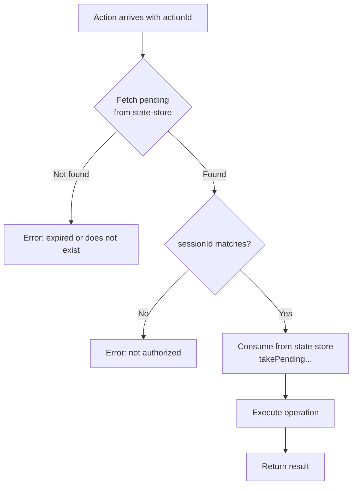

**Key behaviors:**
- Ownership check: only the session that created an approval can consume it. Cross-session approval is rejected.
- `takePendingPlan` / `takePendingTasks` consume the entry from the Map **only after** the DB write succeeds.
- `approve_plan` links provisional documents: if `payload.tempId` is present, it runs `UPDATE documents SET rock_id = newRockId WHERE temp_id = tempId` after `savePlan`.
- Query operations (`query_rock`, `query_sprint`, `query_task`) use `summarizeWithLLM`: the raw DB JSON is passed to Gemini 2.5 Flash (temperature=0.3) which generates a conversational response in the same language as the user's question.
- All date inputs are validated with `userDateToDb` and past dates are rejected by `sql-tools`.
- Sprint start/end order is validated before any DB call. `validateSprintDateOrder` throws an `Error` (rather than returning a string) so callers use `try/catch` instead of conditional checks.
- Each operation is handled by a dedicated async function (`handleCreateRock`, `handleCreateSprint`, etc.). `runDataOperation` is a clean routing table that delegates to these handlers.

**Input:** `{ sessionId, operation, message, rockId?, actionId?, payload? }`  
**Returns:** `{ message, refreshBacklog?, confirmation? }`

---

### 5. Knowledge Agent Node

**File:** `server/agents/knowledge.ts`  
**Purpose:** Answers questions grounded in uploaded documents using semantic search (RAG — Retrieval-Augmented Generation).

**Flow:**

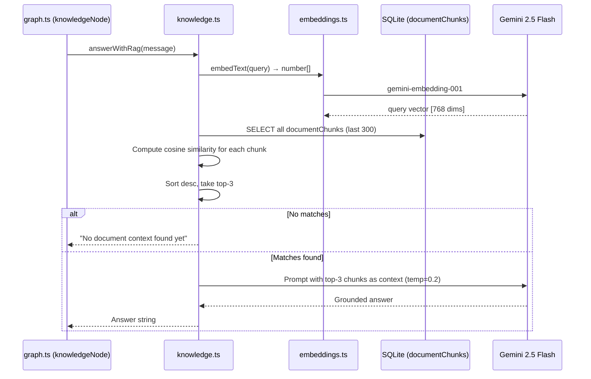

**Key behaviors:**
- Embeddings are 768-dimensional vectors from `gemini-embedding-001`.
- Similarity is computed as cosine similarity in pure TypeScript (no vector DB needed).
- Top-3 chunks are labeled with their score in the prompt context so Gemini can weigh relevance.
- Documents are only searchable after they have been linked to a rock (or while still provisional with a `tempId`). Orphaned provisional documents are cleaned up on server restart.
- If no chunks are found, returns a user-friendly message suggesting document upload.

**Input:** `query: string`  
**Returns:** Answer string

---

### How the Nodes Relate

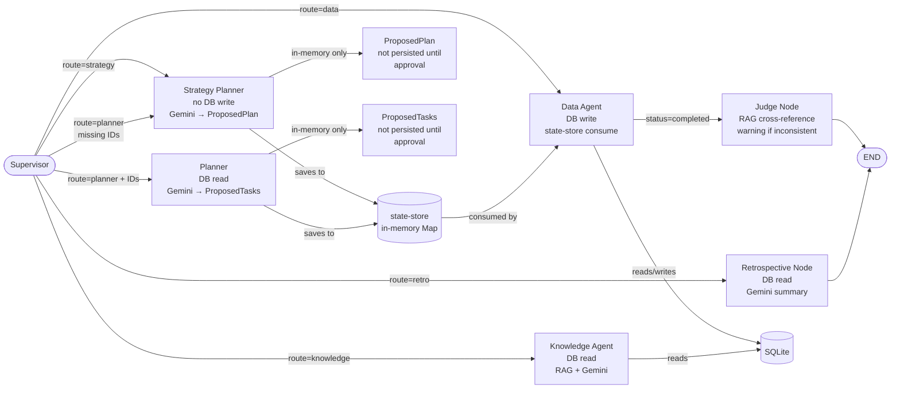

**Summary of relationships:**
- **Supervisor** is the only entry point. All other nodes are only reachable through it.
- **Strategy Planner** and **Planner** both produce proposals that go into `state-store`. Neither writes to the DB directly.
- **Data Agent** is the only node that writes to SQLite. It consumes from `state-store` for approvals.
- **Knowledge Agent** only reads from SQLite (document chunks). It never modifies data.
- `state-store` acts as a temporary handoff layer between generation nodes and the Data Agent, ensuring the user has a chance to review and approve before anything is persisted.

---

## Key Design Decisions

| Decision | Why it exists | Trade-off |
|---|---|---|
| Provisional `tempId` document pattern | Allows document upload before a Rock exists, then links only on approval | Requires cleanup logic for abandoned uploads |
| Deterministic approval bypass | Critical approval actions (`approve_tasks`, `approve_plan`, `confirm_delete`) skip classifier ambiguity | Adds explicit routing branch to maintain |
| `UCard` overflow-visible in app config | Prevents action menus/overlays from being clipped in card containers | Needs deliberate layout testing for edge cases |
| Startup and shutdown orphan cleanup | Keeps provisional storage consistent across restarts and interrupted sessions | Adds lifecycle hooks that must remain reliable |

## Operational Notes for New Developers

- Keep API handlers strict about request boundaries and payload validation.
- Preserve SSE event ordering and terminal `done` event semantics in chat flows.
- Maintain ID contracts: `R-XXXX`, `S-XXXX`, `T-XXXX`.
- Preserve in-memory action state behavior in `state-store` for approval UX continuity.
- Prefer focused, minimal changes across frontend-backend-agent boundaries to avoid regressions in routing or approvals.

## New Features (April 2026)

### Executive Dashboard

- **Page:** `app/pages/dashboard.vue` — fetches `/api/dashboard` and renders KPI cards, task progress counters, per-rock completion bars, and sprints status breakdown.
- **API:** `GET /api/dashboard` — returns:
  - `rocks[]` — each with `totalTasks`, `completedTasks`, `completionPercent`, `status`
  - `sprints[]` — each with `statusBreakdown: { pending, in_progress, completed }`
  - `headcount` — unique task owners, excluding "TBD"
  - `tasksByStatus: { pending, in_progress, completed }`
  - `totals: { rocks, sprints, tasks }`
- **Sidebar:** "Dashboard" nav link added to `AppSidebar.vue` (`i-lucide-bar-chart-2` icon, route `/dashboard`).

### LLM-as-a-Judge

- **Agent:** `server/agents/judge.ts` — exports `judgeTaskCompletion(taskId): Promise<JudgeResult>`.
- **Trigger:** Runs conditionally after `dataNode` when `operation = update_task_status` and `payload.status = completed`.
- **Logic:**
  1. Fetch task description from DB.
  2. Run semantic search (`searchDocuments`) for blocking/incomplete signals.
  3. If matches found, ask Gemini 2.5 Flash to determine consistency.
  4. Returns `{ isConsistent: false, warning: string }` if documents contradict completion.
- **Graph:** `judgeNode` added to `graph.ts` with conditional edge from `data`.
- **SSE:** Emits `{ type: 'judge', message: warning }` when inconsistency detected.
- **UI:** Chat shows amber bubble with `i-lucide-alert-triangle` icon.

### Guardrail Rejection Visible in UI

- **Before:** Guardrail failures (Strategic Anchor, Sprint Boundary, Destruction Guardrail) returned as plain assistant text.
- **After:** `dataNode` sets `guardrailError` in `AgentState`; `chat.post.ts` emits `{ type: 'guardrail', message }` SSE event.
- **UI:** Chat shows red bubble with `i-lucide-shield-alert` icon, distinct from regular errors.
- **Types:** `ChatRole` in `shared/types/chat.ts` now includes `'judge' | 'guardrail'`.

### Sprint Retrospective Agent

- **Agent:** `server/agents/retrospective.ts` — exports `generateRetrospective(sprintId): Promise<string>`.
- **Trigger:** User message contains "retro", "retrospective", "sprint review", or "sprint recap" plus a Sprint ID (S-XXXX).
- **Logic:**
  1. Fetch sprint metadata from DB.
  2. Fetch all tasks for the sprint.
  3. Build task breakdown (completed / in_progress / pending).
  4. Call Gemini 2.5 Flash with structured prompt.
  5. Returns formatted retrospective with sections: Summary, Delivered, Blockers/Pending, Team Performance, Recommendation.
- **Graph:** `retroNode` added; supervisor routes `generate_retrospective` operation to `retro`.
- **Supervisor:** `'generate_retrospective'` added to `IntentOperation`; `'retro'` added to `RouteName`.
- **Output:** Shown as regular assistant message in chat.

### Status Updates via Chat

- **Operations:** `update_sprint_status` and `update_task_status` added to supervisor and data agent.
- **Flow:** User asks to change a status → supervisor detects intent → data agent checks if `payload.status` exists; if not, returns status picker action request with buttons.
- **UI:** Chat shows status option buttons; clicking one sends the update directly. Dropdowns also available inline in `SprintCard` and `TaskCard`.
- **APIs:** `PATCH /api/sprints/[id]` and `PATCH /api/tasks/[id]` validate allowed status values before writing.

## Business Rules & Guardrails

The system enforces three mandatory business rules at the code level in `server/agents/tools/guardrails.ts` and `server/agents/tools/sql-tools.ts`.

### Rules Summary

| Rule | Enforcement Point | Behavior |
|---|---|---|
| Strategic Anchor Rule | `validateCreateTask` | Every task must be linked to a valid Rock ID — no shadow work |
| Sprint Boundary Rule | `validateCreateTask` | Task deadline must fall strictly between Sprint start and end dates |
| Destruction Guardrail (HITL) | `validateDeleteRock` | Rock with active tasks cannot be deleted without human confirmation |

### Guardrail Flow

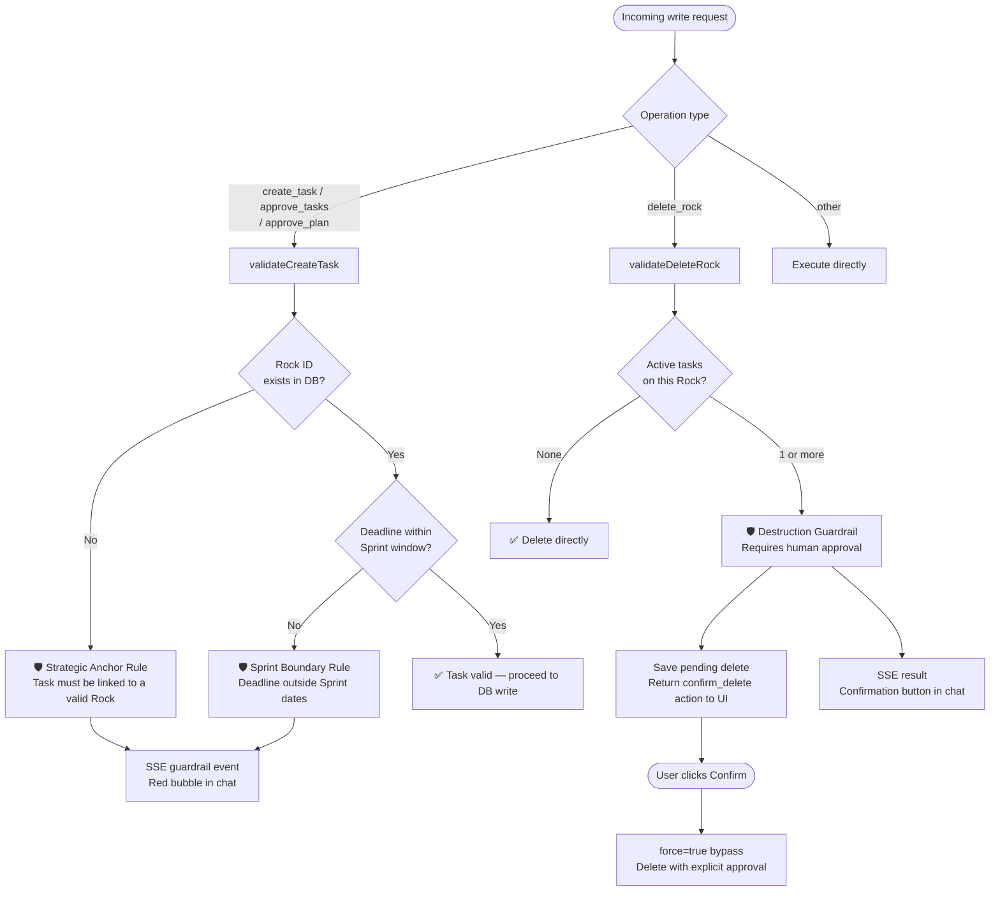

### Sequence: Sprint Boundary Violation

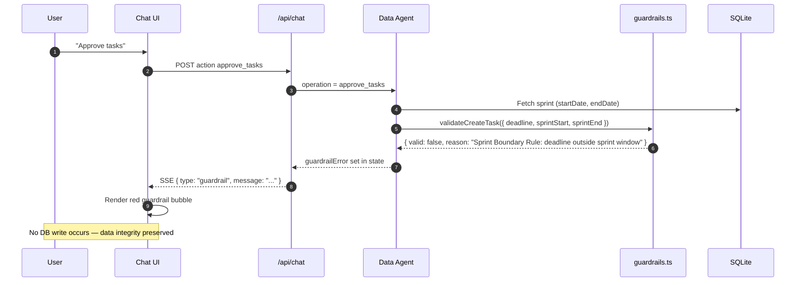

---

## AI-First Development Lifecycle

This project was built following the AI-First Lifecycle mandated by the hackathon brief. Each phase used AI tooling to drive the output rather than manual boilerplate.

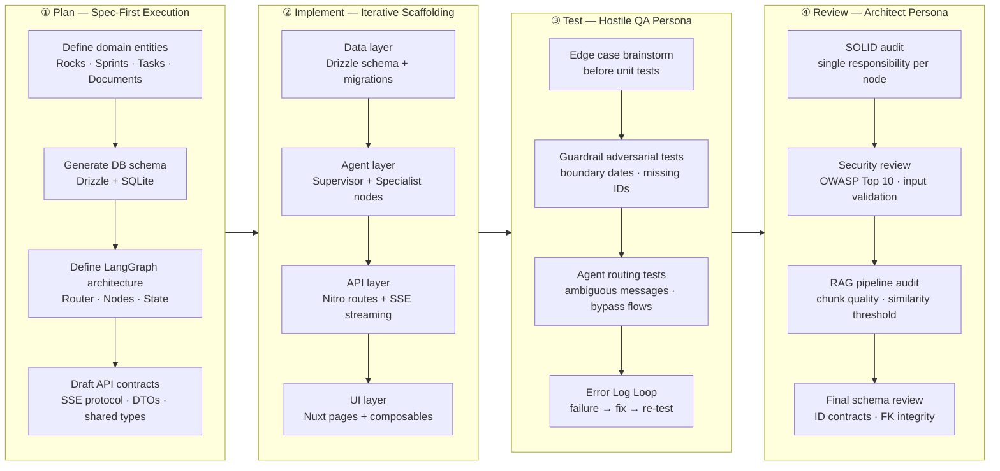

### Spec-First Artifacts Produced

| Artifact | Format | Where |
|---|---|---|
| Database schema | Drizzle TypeScript + ER Diagram (Mermaid) | `server/db/schema.ts` + this document |
| LangGraph architecture | Flowchart (Mermaid) | This document — Agent Routing section |
| API contract (SSE protocol) | JSON event spec | This document — SSE Chat Protocol section |
| Shared DTOs | TypeScript interfaces | `shared/types/` |
| Agent state definition | TypeScript + inline doc | `server/agents/graph.ts` |

---

## LLM-as-a-Judge Flow

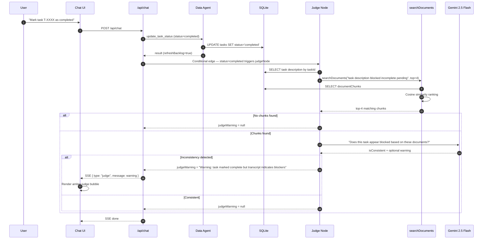

---

## Sprint Retrospective Flow

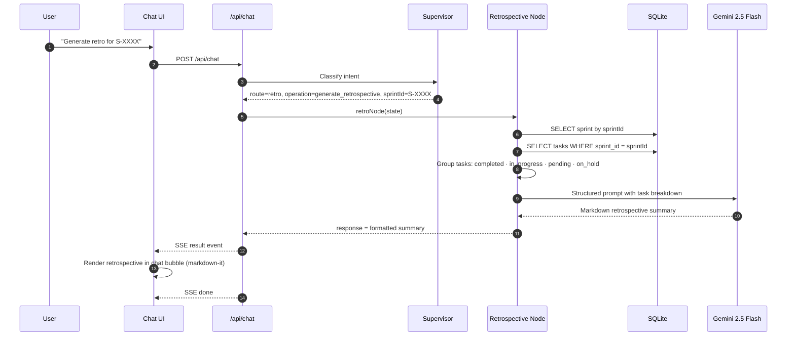
